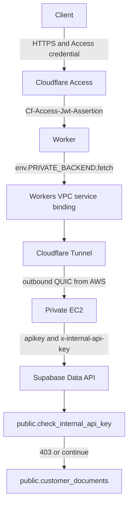

# Architecture

The managed Data API remains a public HTTPS endpoint. This demo adds an application check in front of PostgREST and places the only component that knows the extra secret on a private EC2 instance.

## Components that stay in the path

| Component | Role |
| --- | --- |
| Cloudflare Access | Human login and service-token authentication for every Worker ingress path |
| Worker | Fixed routes, JWT check, header stripping, VPC fetch |
| Workers VPC service | Binds the Worker to one tunnel, host, and port |
| Cloudflare Tunnel | Outbound connector. No public hostname |
| Private subnet and EC2 | Runs `cloudflared` and Fastify. No public IP |
| NAT Gateway | Outbound internet for the tunnel, AWS APIs, and Supabase |
| Fastify | Calls one PostgREST collection with the publishable key and the internal secret |
| Vault | Stores `demo_data_api_gateway_secret` |
| Pre-request function | Rejects a missing, wrong, or unavailable secret with 403 |
| Grants and RLS | `anon` can select public rows only |

The public subnet exists so the NAT Gateway can have an internet route. No instance is placed there. There is no load balancer and no inbound rule on the instance security group.

## What the Worker will call

`GET /health`, `GET /documents`, and `GET /documents/:id`.

The fetch URL is hard-coded to `http://127.0.0.1:8080`. The VPC service is created with `--ipv4 127.0.0.1 --http-port 8080`. A caller cannot supply a different origin, query string, or Supabase path.

## What Fastify will call

`GET https://<project-ref>.supabase.co/rest/v1/customer_documents`

The query string is built in code: `select=id,title,visibility,created_at`, plus either `order=created_at.asc` or `id=eq.<uuid>`. There is no `Accept-Profile` header and no `service_role` key. Redirects are rejected so the secret cannot follow a redirect to another host.

Visibility filtering is left to RLS. The backend projects the four columns and does not drop `private` rows itself. If a private title shows up in an `anon` response, RLS is not doing its job and the integration test fails.

## Failure behavior

| Condition | Result |
| --- | --- |
| No Access credential | Access returns 401, 403, or a login redirect. The Worker also returns 401 if a request arrives without a valid JWT |
| Worker cannot reach the tunnel | 502 or 504 from the Worker |
| Backend rejects `x-backend-auth` | Worker returns 502. This is a different credential from Access |
| Missing or wrong `x-internal-api-key` | Data API returns 403 |
| Valid secret, `anon` key | Public rows only |
| Valid secret plus `POST`, `PATCH`, or `DELETE` | Permission denied |
| Direct call from any network with the valid secret | The Data API accepts it. Test I records that result on purpose |
